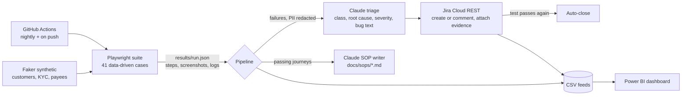

# BSG-Loop: AI-assisted QA, defect tracking and SOP automation for a banking app


One connected pipeline, the way a digital-banking team actually works: **test → triage → track → document → report**.
A scheduled Playwright suite runs against a demo banking site; every failure is classified by Claude, filed in Jira
(deduplicated, with screenshot and log), and closed automatically when the test passes again. The same runs keep
user-manual SOPs and a Power BI dashboard up to date.



## What is different about this project
| | |
|---|---|
| **Tests write the documentation** | Journeys tagged `@sop` record screenshotted steps; Claude turns them into SOPs using *only* those steps. Screenshots refresh on every green run; if the journey fails, its SOP is flagged `drift suspected`. |
| **Closed-loop defect tracking** | Failures dedupe by fingerprint label (no ticket spam), repeat failures add a comment, and a bug closes itself when its test passes. Cycle time in the dashboard is real, not hand-edited. |
| **The AI is measured, not just demoed** | Canary tests carry a ground-truth failure class. Each run scores Claude's classification against it (`dashboard/triage_eval.csv`). |
| **Bank-grade guard rails** | PII-shaped strings (emails, PAN-format IDs, card/phone numbers, passwords) are redacted before anything reaches the API; model output is validated and falls back to a rule-based classifier if the API is unavailable; failure text is treated as untrusted input in the prompt. |
| **Synthetic, Indian-context data** | Faker (`en_IN`) generates customers with KYC-style fields (PAN-format ID, IFSC-style code, UPI id, income band) and Luhn-valid test card numbers. All values are random; none are real identities. |

## Coverage
41 browser test cases (+6 opt-in canaries) across five modules:

| Module | Cases | Includes |
|---|---|---|
| Login | 9 | valid, logout, wrong password, unknown user, empty fields, SQL-injection string, 300-char username |
| Registration (onboarding) | 13 | data-driven valid customers, each required field blank, password mismatch, duplicate username |
| Open account | 3 | savings and checking, new account appears in overview |
| Fund transfer | 9 | balance verified on both accounts, boundary amounts, zero / negative / non-numeric / empty / malformed |
| Bill pay | 7 | valid, balance reduced, missing payee, account mismatch, invalid amounts |

## Quick start
```bash
git clone https://github.com/<your-username>/bsg-loop && cd bsg-loop
python -m venv .venv && source .venv/bin/activate      # Windows: .venv\Scripts\activate
pip install -r requirements.txt && python -m playwright install chromium
cp .env.example .env                                    # add Anthropic + Jira credentials (both optional)

pytest tests_unit                                       # offline unit tests for the pipeline
pytest tests --html=results/report.html --self-contained-html
python -m pipeline.run_pipeline                         # triage -> Jira -> SOPs -> dashboard CSVs
```
- No Jira credentials: runs in dry-run mode and writes bug payloads to `results/jira_dryrun/`.
- No Anthropic key: uses the rule-based fallback classifier and the recorded step text for SOPs.
- `RUN_CANARIES=1 pytest tests` adds the six deliberately failing tests so the Jira and triage path can be demonstrated on demand.
- Preview the pipeline without touching the demo site: `python -m scripts.make_mock_run && python -m pipeline.run_pipeline --no-ai --no-jira` (mock data, never for screenshots).

### Jira setup (5 minutes)
Create a free Jira Cloud site, a project (key e.g. `BANK`) with a **Bug** issue type, and an API token
(id.atlassian.com → Security → API tokens). Put the values in `.env` and in the repo's Actions secrets
(`ANTHROPIC_API_KEY`, `JIRA_BASE_URL`, `JIRA_EMAIL`, `JIRA_API_TOKEN`, `JIRA_PROJECT_KEY`).

### Dashboard
`dashboard/POWERBI.md` has the load steps, DAX measures and visual layout: pass-rate trend, severity split,
defect ageing, open-to-closed cycle time, scenario coverage by module, and triage accuracy.

## Mapping to the Axis BSG role
| BSG responsibility | Where it lives |
|---|---|
| Test automation for retail channels | `tests/`, `framework/parabank.py` |
| AI-driven user manual / process documentation | `pipeline/sop_generator.py`, `docs/sops/` |
| JIRA dashboards, MIS and SOPs | `pipeline/jira_client.py`, `pipeline/dashboard_feed.py`, `dashboard/` |
| Power BI reporting metrics | `dashboard/POWERBI.md` |
| Synthetic data for testing | `framework/data.py` |
| AI adoption initiatives | `pipeline/triage.py` (with evaluation) |
| Banking / payments context | transfer, bill-pay, onboarding journeys with balance and ledger checks |

## Results (fill in from your own runs)
| Metric | Value |
|---|---|
| Test cases / pass rate (latest run) | _ |
| Bugs auto-filed / auto-closed | _ |
| Triage accuracy on labelled canaries (Claude vs rule-based) | _ |
| SOPs generated | _ |

## Limitations (read before trusting a number)
- Runs against the **public ParaBank demo**, a deliberately imperfect training app that is shared and periodically reset. Failures can be real quirks of that app, selector drift, or environment noise: that is exactly what the triage step is for, but check the screenshot before calling anything a defect.
- Canaries are deliberately failing tests with a known label. Their Jira tickets carry the `canary` label and are excluded from headline dashboard numbers. The "real defect" canaries encode a specification the app does not follow; they do not claim ParaBank has that defect.
- Triage accuracy from a handful of canaries is indicative, not statistically meaningful. Add more labelled failures to tighten it.
- "Scenario coverage by module" is test distribution (positive / negative / boundary), not code coverage.
