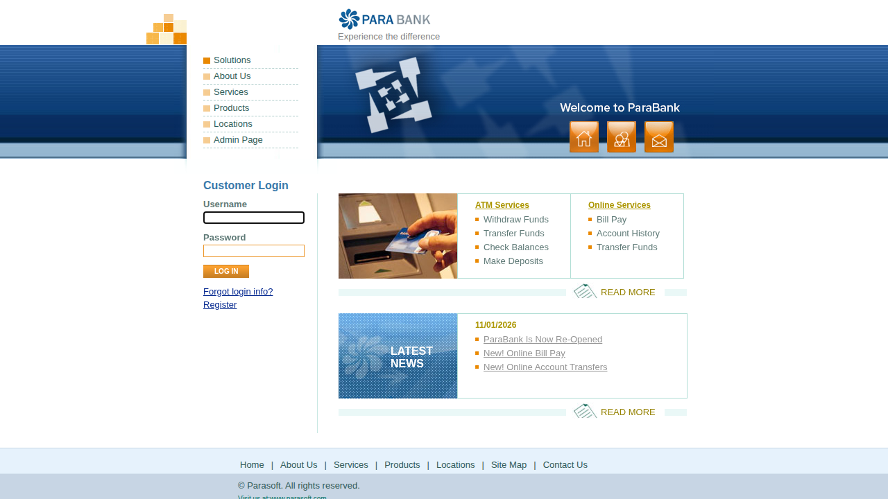
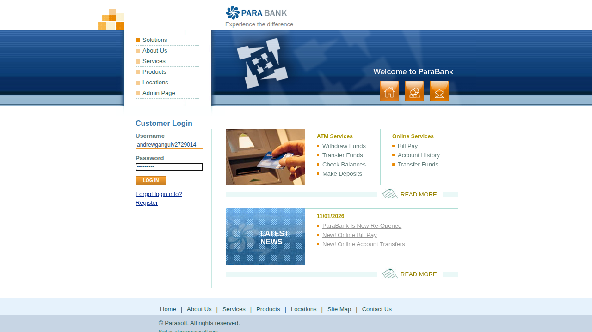
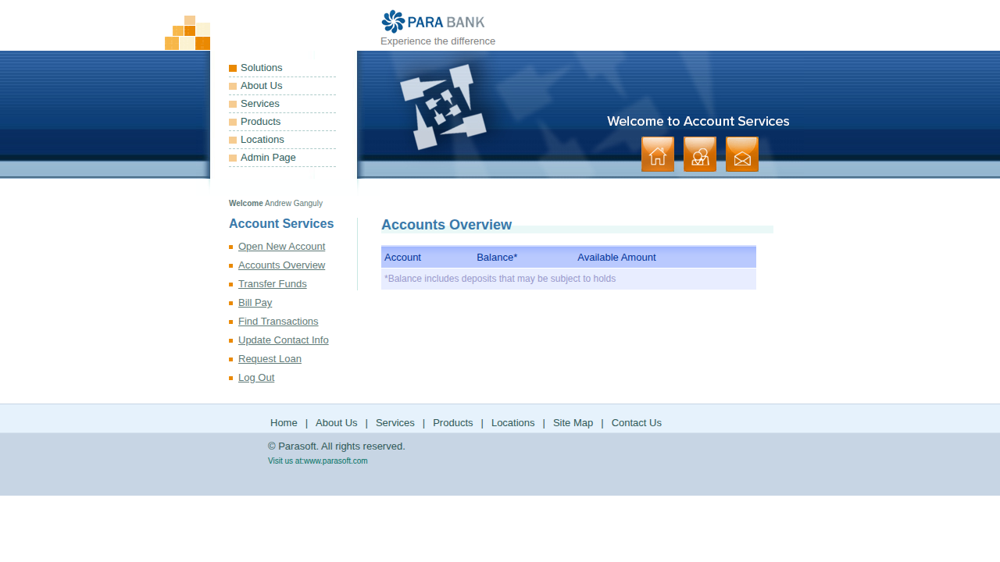

# Log in to online banking

<!--status-->⚠️ **Possible drift** - the automated test for this journey failed in run `20261104T031736Z`. Verify before relying on this SOP.

_Auto-generated from test `tests/test_login.py::test_login_valid_credentials[chromium]` (recorded-steps)._

## Purpose
Log in to online banking

## Prerequisites
- Access to the online banking application

## Procedure

### Step 1
Open the online banking home page

### Step 2
Enter your username and password in the Customer Login panel

### Step 3
Select Log In - the Accounts Overview page confirms you are signed in

## Expected result
Select Log In - the Accounts Overview page confirms you are signed in
