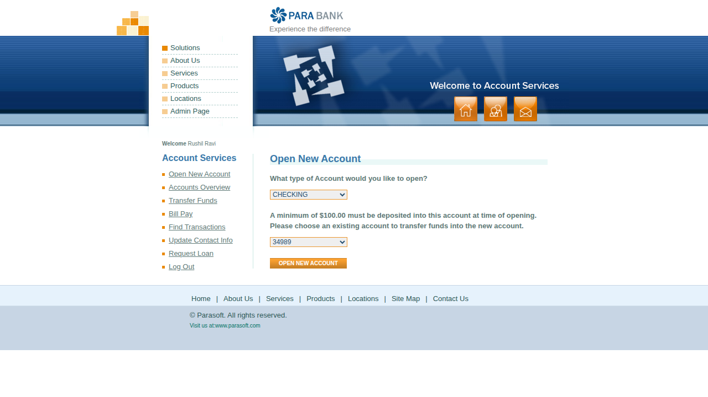

# Open a new savings account

<!--status-->✅ Verified by passing automated run `20261023T180504Z` (commit `5844c91`).

_Auto-generated from test `tests/test_open_account.py::test_open_savings_account[chromium]` (recorded-steps)._

## Purpose
Open a new savings account

## Prerequisites
- Access to the online banking application

## Procedure

### Step 1
Select Open New Account from the left-hand menu

### Step 2
Choose SAVINGS as the account type and pick the account to fund it from

### Step 3
Select Open New Account - the new account number is displayed

## Expected result
Select Open New Account - the new account number is displayed
