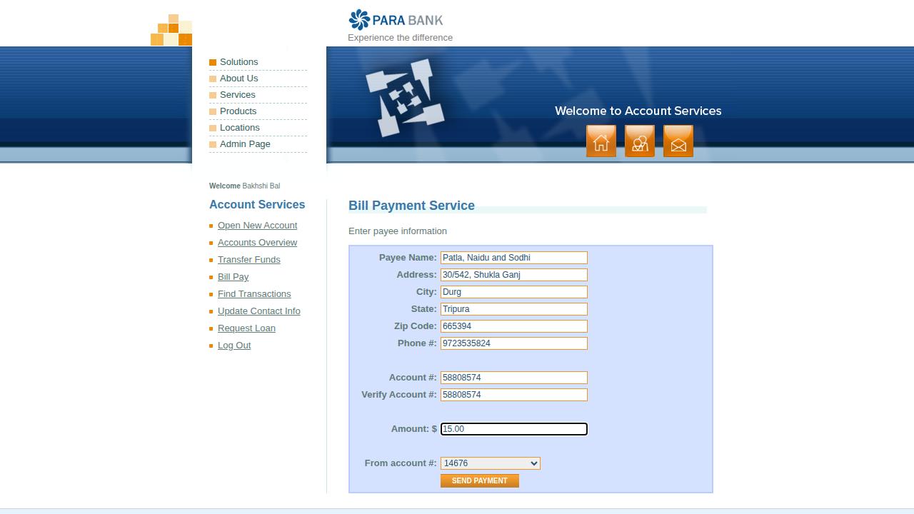
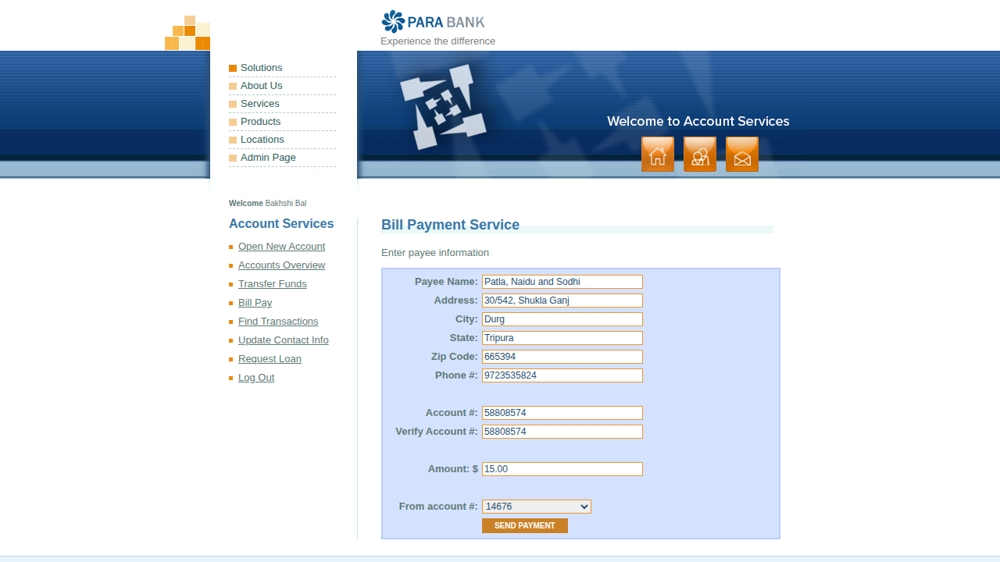

# Pay a bill to a new payee

<!--status-->✅ Verified by passing automated run `20261026T030309Z` (commit `e3a335a`).

_Auto-generated from test `tests/test_billpay.py::test_bill_payment_valid[chromium]` (recorded-steps)._

## Purpose
Pay a bill to a new payee

## Prerequisites
- Access to the online banking application

## Procedure

### Step 1
Select Bill Pay from the left-hand menu

### Step 2
Enter the payee name, address, phone and account number (twice), the amount and the account to pay from

### Step 3
Select Send Payment - a confirmation shows the payee, amount and paying account

## Expected result
Select Send Payment - a confirmation shows the payee, amount and paying account
