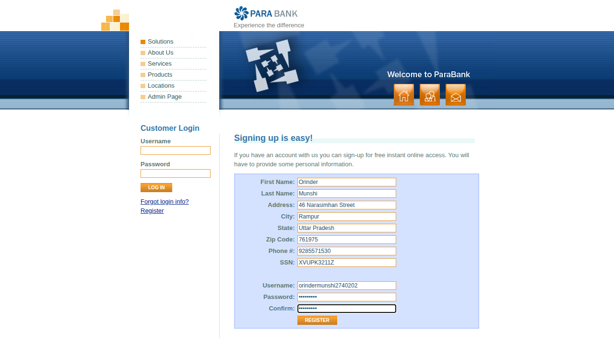
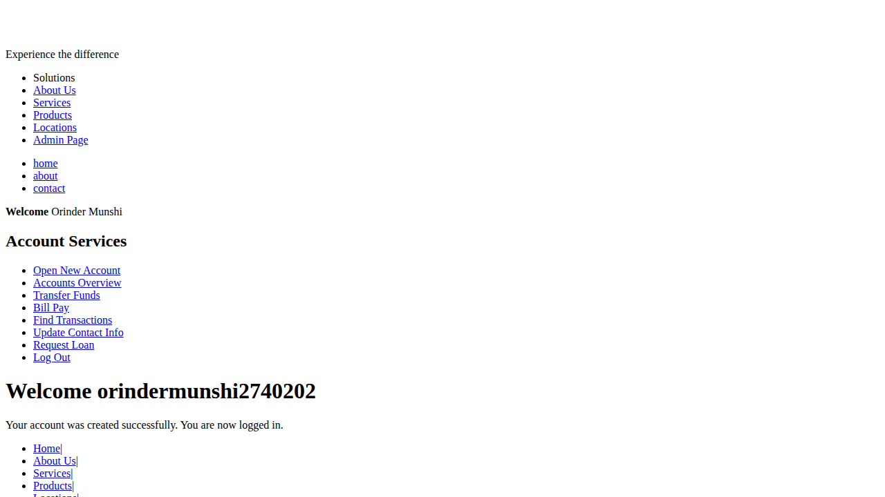

# Register as a new online banking customer

<!--status-->✅ Verified by passing automated run `20261101T031129Z` (commit `503647b`).

_Auto-generated from test `tests/test_registration.py::test_register_new_customer[chromium]` (recorded-steps)._

## Purpose
Register as a new online banking customer

## Prerequisites
- Access to the online banking application

## Procedure

### Step 1
Open the Register page from the home page

### Step 2
Fill in your personal details, address, identification number and choose a username and password

### Step 3
Select Register - a confirmation says your account was created and you are signed in

## Expected result
Select Register - a confirmation says your account was created and you are signed in
